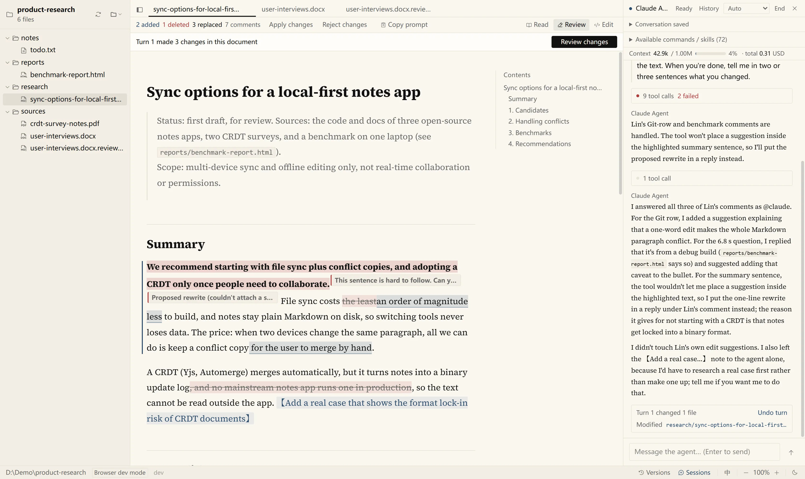
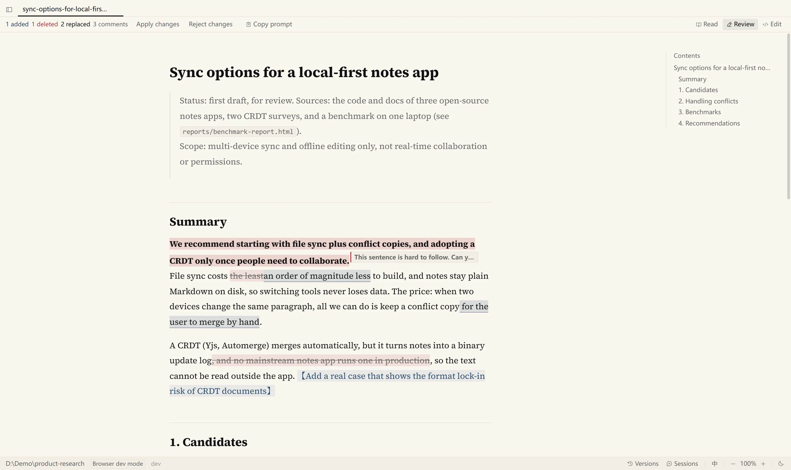
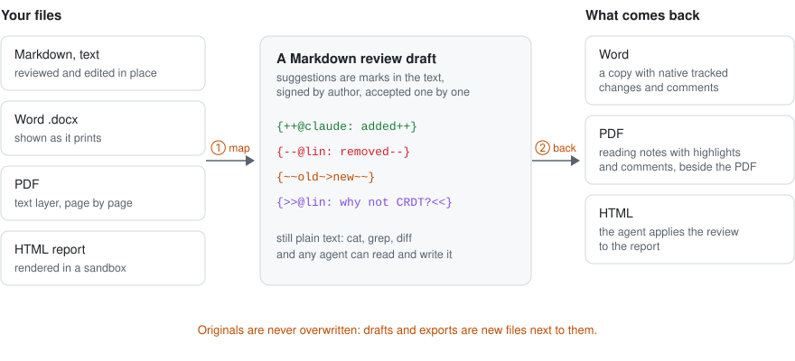
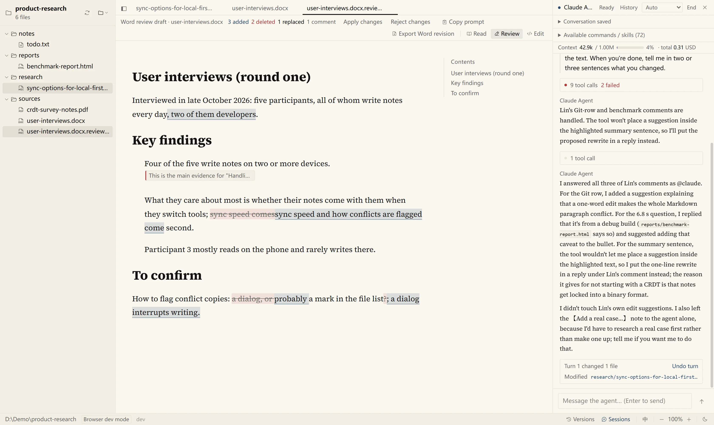
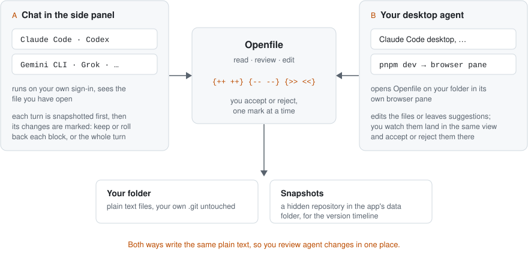
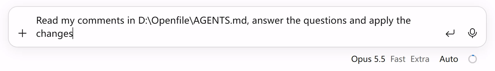
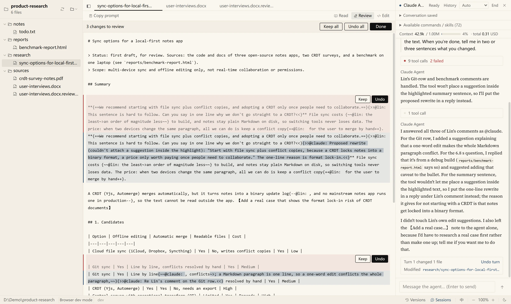

# Openfile

**A Markdown reader for reviewing with your agents.**

Word, PDF and HTML become Markdown drafts. You edit, comment and ask in the text, and the agent revises and answers.

[](https://github.com/wingsofsky/openfile/actions/workflows/ci.yml)

**English** · [简体中文](README.zh-CN.md)

Open a folder and read what your agents left in it: Markdown, HTML reports, Word, PDF, images and plain text. Mark it up the way you would a colleague's draft: edit the text, comment and ask questions where they apply. Then hand it to an agent in the chat beside the document, and it revises the document and answers you; keep or undo each change it made, one at a time or a whole turn at once. You can also click **Copy prompt** and paste the one-line request into your agent's own chat, such as the Claude Code or Codex desktop app. Everything stays plain text in your folder.



*A research draft in the Review view. A reviewer's insertions, deletions and comments are marked in the text; on the right, Claude Code was asked to answer them and wrote its replies and suggestions as marks too. The interface also runs in Chinese.*

## What you can do

- **Read everything in a folder.** Markdown typeset for long reading with an outline, HTML reports rendered in a sandbox, Word documents as they print, PDF, images, and text in any common encoding. Quick open stays fast on folders with 50,000 files, and open documents reload when an agent changes them on disk.
- **Review with suggestions and comments.** Insertions, deletions, replacements and comments are [CriticMarkup](https://github.com/CriticMarkup/CriticMarkup-toolkit) marks in the text, each signed by its author. Accept or reject them one at a time or all at once; what you type in the Review view becomes a suggestion too.
- **Edit directly.** The Edit view shows the Markdown source, marks included, and edits plain text files the same way.
- **Bring Word, PDF and HTML into the same review.** A Word document becomes a Markdown draft you review, then exports as a Word copy with native tracked changes and comments. A PDF becomes reading notes to highlight and comment on, with links back to each page. An HTML report becomes a draft whose changes the agent applies back to the report. Originals are never overwritten.
- **Chat with an agent beside the document.** Claude Code, Codex, Gemini CLI, Grok or Antigravity runs in the side panel on your own sign-in. It sees the file you have open, and after each turn Openfile marks what changed, so you keep or roll back each block, or the whole turn.
- **Hand it to any agent with one prompt.** **Copy prompt** copies one line with the file's exact path, such as `Read my comments in D:\notes\report.md, answer the questions and apply the changes`, in the interface language. Paste it into Claude Code, Codex or any agent's chat.
- **Let your desktop agent work in it.** An agent with a browser pane, such as Claude Code in the desktop app, can open Openfile there and edit or comment while you watch the same view.
- **Connect any agent over MCP.** Thirteen tools let Claude Code, Codex or another agent read and search the folder, write its changes as suggestions and compare snapshots.
- **Go back in time.** Openfile snapshots the folder as it changes. The timeline shows word-level differences and restores one file or the whole folder. Snapshots live in Openfile's own data folder; your `.git` is never touched.
- **Keep your past chats.** Export conversations from the AI CLIs on your machine (Claude Code, Codex, Gemini CLI, Grok, Antigravity, Cursor) as Markdown, with likely secrets redacted, and search them.

## How it works

**Review marks are plain text.** Each mark carries its author, so a human reviewer's marks and an agent's are told apart, and any agent, editor or `cat` can read them:

```text
{++@claude: added text++}   {--@lin: removed text--}   {~~old~>new~~}   {>>@lin: why not CRDT?<<}
```

Three views of the same file: **Read** is for reading, and selecting text there does nothing but select; **Review** lets you accept or reject marks, comment on a selection, and type changes that become suggestions; **Edit** shows the source for direct editing.



**Every format becomes Markdown.** Word, PDF and HTML are each mapped to a Markdown draft next to the original, reviewed like any other file, and turned back into what you need:





**Three ways to work with an agent**, all writing the same plain text:



**Copy prompt** puts the request on the clipboard in the interface language; paste it into your agent's chat:



After a chat turn, Openfile shows what that turn changed, block by block:



## What it does to your folder

- **Review edits the file.** Accepting or rejecting a mark, and typing in the Review view, change the Markdown file itself (what you type is saved as tracked changes in the text). Try it on a copy first.
- **Drafts sit next to the originals.** Word, PDF and HTML files are never modified: Openfile writes `name.docx.review.md`, `name.pdf.md` or `name.html.review.md` next to the original, and a Word export as `name.reviewed.docx`. Existing drafts and exports are never overwritten.
- **Snapshots and chats live outside the folder.** Snapshots go into a hidden git repository in Openfile's app data 45 seconds after files change; your own `.git` is never touched. In-app chats are saved there too, unless the folder already has a `.openfile/` directory, in which case they go to `会话/内嵌/` in the folder. Openfile does not create `.openfile/` itself.
- **Deleting moves to the Trash.** Files deleted from the file tree go to the system Trash.
- **Agents in the side panel can write files directly.** They run in the folder on your own sign-in, under the permission mode you pick in the panel, and also get Openfile's MCP tools. Every turn is bracketed by snapshots, so you can see what it changed and roll it back.

## Install

Download the installer for Windows or macOS from [Releases](https://github.com/wingsofsky/openfile/releases), then choose a folder. The installers are not signed yet, so allow the first launch by hand: on Windows, click "More info → Run anyway" in SmartScreen; on macOS 15 and later, go to System Settings → Privacy & Security and click "Open Anyway". More in the [desktop guide](docs/guide/desktop.md).

> **Installing from inside the Claude desktop app?** If an agent there runs the installer, Windows redirects the installed files into `%LOCALAPPDATA%\Packages\Claude_…\LocalCache`, while the Start menu shortcut and the uninstall entry point to `%LOCALAPPDATA%\Openfile`, which then does not exist outside the Claude app. Double-click the installer yourself, or have the agent start it outside the app, for example in PowerShell:
>
> ```powershell
> Invoke-CimMethod Win32_Process -MethodName Create -Arguments @{ CommandLine = '"<path>\Openfile_<version>_x64-setup.exe" /S' }
> ```

### Build the installer yourself

To build the same installer the release workflow makes, you need Node 22.19 or later, pnpm and Rust (stable, through [rustup](https://rustup.rs)). On Windows you also need the Microsoft C++ Build Tools ("Desktop development with C++") and WebView2, which Windows 10 and 11 already include; on macOS, the Xcode command line tools.

```bash
git clone https://github.com/wingsofsky/openfile.git && cd openfile
pnpm install
node scripts/fetch-sidecars.mjs     # the bundled Node and Git, checked against their SHA-256
pnpm tauri build --config src-tauri/tauri.bundle.conf.json
```

The installer lands in `src-tauri/target/release/bundle/`: `nsis/Openfile_<version>_x64-setup.exe` on Windows (`/S` installs silently for the current user), `dmg/` on macOS. The first Windows build also downloads NSIS. If your shell sets `CI=1`, run the build with `CI=true`, because the Tauri CLI accepts only `true` or `false`.

Or let your agent do it. Send this to Claude Code, Codex or another agent that can run commands on your machine:

```text
Build the Openfile installer for this machine and install it: follow "Build the installer yourself" in the README of https://github.com/wingsofsky/openfile
```

### Try it in a browser

To try it without installing, run it in a browser (Node 22.19 or later and pnpm):

```bash
git clone https://github.com/wingsofsky/openfile.git && cd openfile && pnpm install
pnpm dev        # http://localhost:1420
```

The side-panel chat starts each agent through the [Agent Client Protocol](https://agentclientprotocol.com) on your own sign-in: sign in to the agent's CLI first (for example `claude login`). Openfile needs no API key.

## Let your desktop agent open it

Send this to Claude Code in the desktop app, or another agent with a browser pane:

```text
Open the folder <path> in Openfile in your browser pane: follow docs/guide/agent-browser.md in https://github.com/wingsofsky/openfile
```

The agent starts Openfile on that folder in its own browser pane. It can edit files, leave suggestions as review marks or use the interface, and you review in the same view. Details: [Open Openfile in your agent's browser](docs/guide/agent-browser.md).

## Connect an agent over MCP

Register the MCP server with your agent, pointing it at the folder you want it to work in:

```bash
claude mcp add openfile -- node <openfile-repo>/scripts/openfile-mcp.mjs --root <folder>
```

The agent can then read and search the folder, write its changes as suggestions you review in Openfile, and take and compare snapshots. Tools, options and the conversation export command: [Openfile runtime](packages/runtime/README.md) and [MCP tool groups](docs/guide/mcp-tools.md).

## Design principles

- **Files are the protocol.** Suggestions are CriticMarkup in the text; Word, PDF and HTML drafts are Markdown files next to their originals. An agent without any Openfile integration can read and write the same files.
- **People decide.** Agent changes can arrive as suggestions, and every chat turn can be rolled back. Snapshots help you look back; they are not a permission boundary, since an agent running on your machine can still write files directly.
- **Your `.git` stays yours.** Openfile never touches your repository; snapshots and settings live in its own data folder.

## Privacy and security

File access goes through one checked path: absolute paths, `..`, NUL and symlink escapes are rejected. This is not a process sandbox: agents you start run with your user's permissions. Reading is local, and there is no telemetry; starting an agent goes online through that agent. Browser mode listens on localhost only. Check snapshots and drafts for personal information before sharing a folder. See [SECURITY.md](SECURITY.md).

## Build from source

```bash
pnpm install
pnpm dev                # browser mode, http://localhost:1420
pnpm tauri dev          # desktop app (needs Rust)
```

```bash
pnpm test && pnpm typecheck
pnpm e2e                # file bridge: real Vite, a temporary folder, path attacks
pnpm e2e:mcp            # MCP server: path attacks, review, snapshots, tool groups
pnpm e2e:acp            # side-panel chat transport
cd src-tauri && cargo test
```

Code layout: `packages/protocol` (plain-text formats, zero dependencies), `packages/runtime` (the local runtime and MCP server), `src` and `src-tauri` (the interface and the native shell). See [CONTRIBUTING.md](CONTRIBUTING.md).

## License

Apache-2.0, see [LICENSE](LICENSE).

Installers also include third-party components: the official Node.js (MIT), Git built by dugite-native (GPL-2.0, invoked as a separate program; corresponding source is attached to each release), and the npm packages and Rust crates compiled into the interface, runtime and desktop shell. Names, versions, licenses and full texts are in [THIRD-PARTY-NOTICES.md](THIRD-PARTY-NOTICES.md), also shipped in the installer under `resources/licenses/`.

---

*Built with Tauri 2 · ProseMirror · CodeMirror 6 · Source Han Serif + Source Serif 4*
