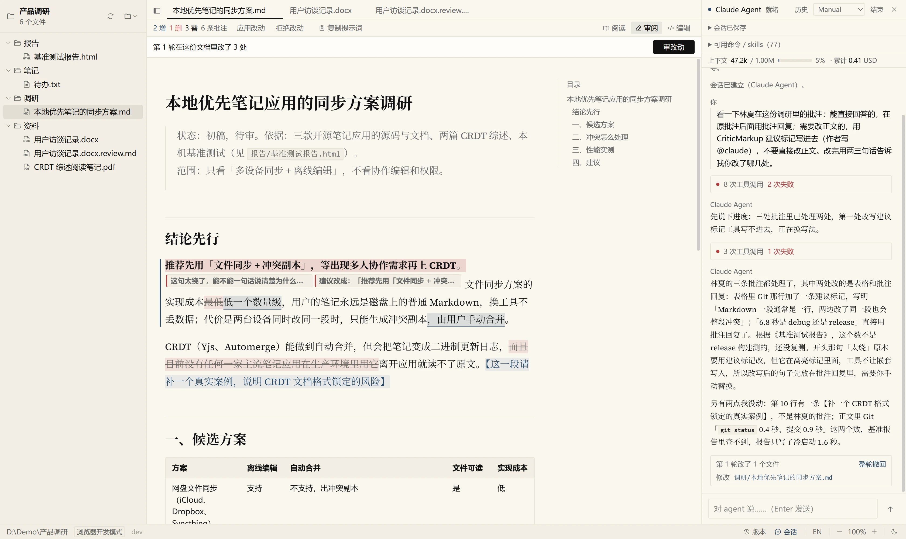
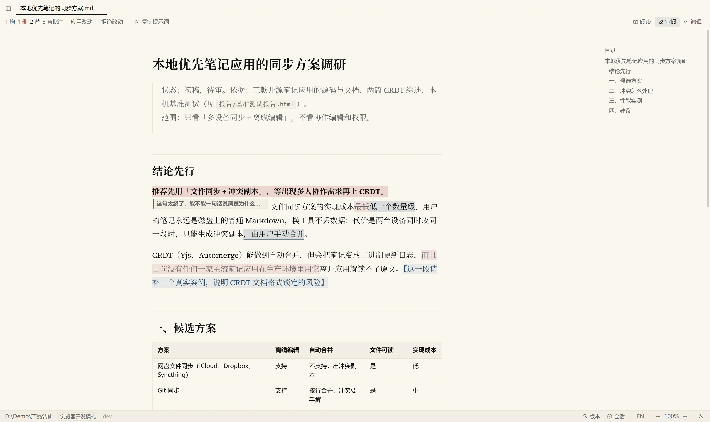
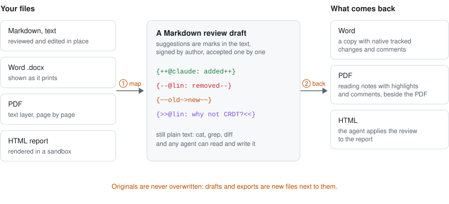
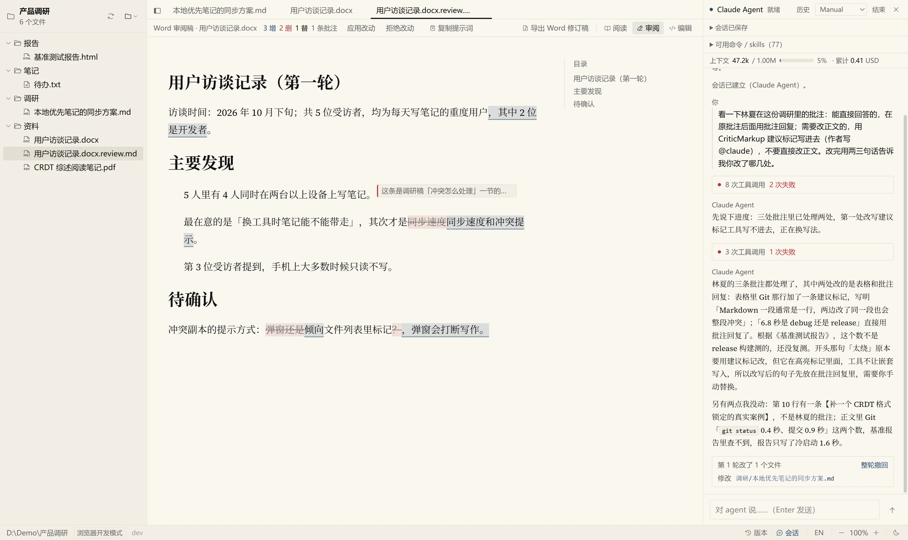
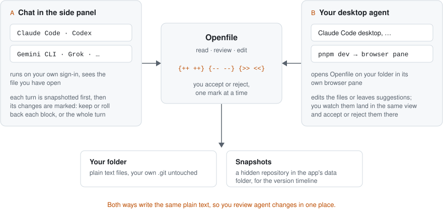
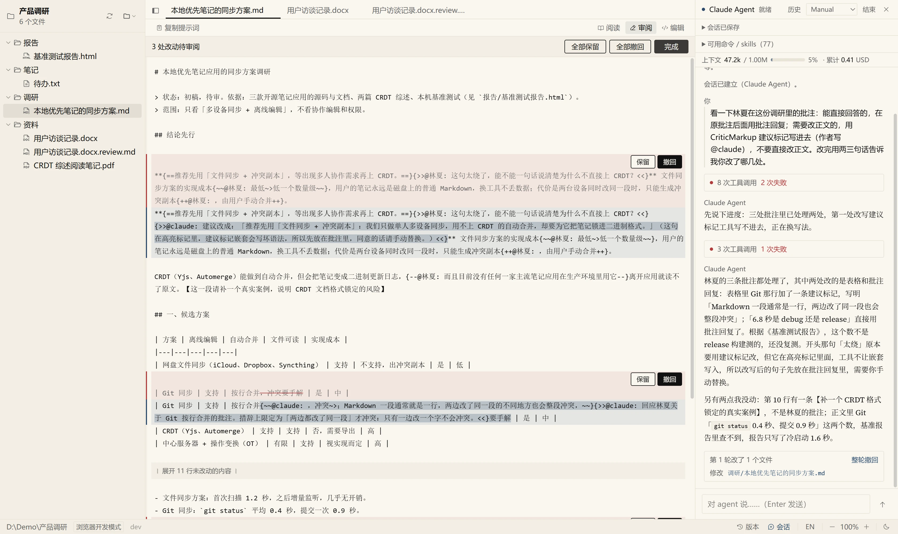

# Openfile

**为 AI agent 写出来的文件做的阅读器，也是和 agent 一起审阅的地方。**

[](https://github.com/wingsofsky/openfile/actions/workflows/ci.yml)

[English](README.md) · **简体中文**

打开一个文件夹，读 agent 留在里面的东西：Markdown、HTML 报告、Word、PDF、图片和纯文本。像审同事的稿子一样审它：修改建议和批注一条一条接受或拒绝；也可以在文档旁边的对话里让 agent 一起改。所有东西都以纯文本留在你的文件夹里。



*审阅模式下的一份调研稿。审稿人的插入、删除和批注都标在正文里；右栏让 Claude Code 回应这些批注，它的回复和修改建议也写成了标记。界面可以在中文和英文之间切换。*

## 能做什么

- **读整个文件夹。** Markdown 排好版、带目录，适合长读；HTML 报告在沙箱里渲染；Word 按打印效果显示；还有 PDF、图片和各种常见编码的文本。5 万个文件的文件夹里快速打开照样快；agent 在磁盘上改了文件，打开的文档会自动刷新。
- **用修改建议和批注审阅。** 插入、删除、替换和批注都是正文里的 [CriticMarkup](https://github.com/CriticMarkup/CriticMarkup-toolkit) 标记，每条带作者署名。可以逐条或一次性接受、拒绝；你在审阅模式里打的字也会变成修改建议。
- **直接编辑。** 编辑模式显示带标记的 Markdown 原文，纯文本文件也用这个模式改。
- **Word、PDF、HTML 进同一套审阅。** Word 转成一份 Markdown 审阅稿，审完导出带 Word 原生修订和批注的副本；PDF 转成可以高亮、批注的阅读笔记，每页都能跳回原文；HTML 报告转成审阅稿，由 agent 把改动写回报告。原件永远不会被覆盖。
- **在文档旁边和 agent 对话。** Claude Code、Codex、Gemini CLI、Grok 或 Antigravity 在侧栏里运行，用的是你自己的登录。agent 能看到你正打开的文件；每一轮结束后，Openfile 标出改了什么，你可以逐块保留或撤回，也可以整轮撤回。
- **让桌面版 agent 进来干活。** 带浏览器面板的 agent（比如桌面应用里的 Claude Code）可以在面板里打开 Openfile，直接改或写批注，你在同一个画面里看着。
- **通过 MCP 接入任何 agent。** 13 个工具让 Claude Code、Codex 或别的 agent 读取、搜索文件夹，把修改写成建议，拍快照并对比。
- **随时回到过去。** Openfile 在文件夹变化时自动拍快照。时间线按词显示差异，可以恢复单个文件或整个文件夹。快照存在 Openfile 自己的数据目录里，从不碰你的 `.git`。
- **留住历史对话。** 把本机各家 AI CLI（Claude Code、Codex、Gemini CLI、Grok、Antigravity、Cursor）的对话导出成 Markdown，自动脱敏常见密钥，并且可以检索。

## 怎么做到的

**审阅标记就是纯文本。** 每条标记带作者，人改的和 agent 改的一眼分得清；任何 agent、编辑器或 `cat` 都读得懂：

```text
{++@claude: 新加的文字++}   {--@林夏: 删掉的文字--}   {~~旧~>新~~}   {>>@林夏: 为什么不直接上 CRDT？<<}
```

同一个文件有三种看法：**阅读**，选中文字只是选中，不弹任何东西；**审阅**，接受或拒绝标记、选中文字加批注、打字直接变成修改建议；**编辑**，显示原文直接改。



**各种格式都映射成 Markdown。** Word、PDF、HTML 都在原件旁边生成一份 Markdown 稿，和别的文件一样审，再转回你要的样子：





**和 agent 一起改的两种办法**，写的都是同一份纯文本：



一轮对话结束后，Openfile 按块列出这一轮改了什么：



## 安装

从 [Releases](https://github.com/wingsofsky/openfile/releases) 下载 Windows 或 macOS 的安装包，装好后选一个文件夹。安装包还没有签名，第一次启动要手动放行：Windows 在 SmartScreen 里点「更多信息 → 仍要运行」；macOS 15 及以后到「系统设置 → 隐私与安全性」里点「仍要打开」。更多见[桌面版指南](docs/guide/desktop.md)（英文）。

> **在 Claude 桌面版里安装？** 让那里的 agent 运行安装器时，Windows 会把装好的文件重定向到 `%LOCALAPPDATA%\Packages\Claude_…\LocalCache`，而开始菜单快捷方式和卸载项指向 `%LOCALAPPDATA%\Openfile`，这个目录在 Claude 之外并不存在。请自己双击安装器，或者让 agent 在 Claude 之外启动它，比如在 PowerShell 里：
>
> ```powershell
> Invoke-CimMethod Win32_Process -MethodName Create -Arguments @{ CommandLine = '"<路径>\Openfile_<版本>_x64-setup.exe" /S' }
> ```

### 自己打安装包

要打出和发版流程一样的安装包，需要 Node 22.19 及以上、pnpm 和 Rust（stable，用 [rustup](https://rustup.rs) 装）。Windows 还需要 Microsoft C++ 生成工具（「使用 C++ 的桌面开发」）和 WebView2，Windows 10、11 已经自带 WebView2；macOS 需要 Xcode 命令行工具。

```bash
git clone https://github.com/wingsofsky/openfile.git && cd openfile
pnpm install
node scripts/fetch-sidecars.mjs     # 随包的 Node 和 Git，按 SHA-256 校验
pnpm tauri build --config src-tauri/tauri.bundle.conf.json
```

安装包在 `src-tauri/target/release/bundle/` 下：Windows 是 `nsis/Openfile_<版本>_x64-setup.exe`（加 `/S` 静默装到当前用户），macOS 在 `dmg/`。Windows 第一次构建还会下载 NSIS。如果你的 shell 设了 `CI=1`，构建时改成 `CI=true`，因为 Tauri CLI 只认 `true` 或 `false`。

也可以交给 agent。把这句话发给 Claude Code、Codex 或别的能在你电脑上跑命令的 agent：

```text
为这台电脑打 Openfile 的安装包并装上：按 https://github.com/wingsofsky/openfile 的 README 里「自己打安装包」一节做
```

### 在浏览器里试用

不想安装，也可以在浏览器里跑（需要 Node 22.19 及以上和 pnpm）：

```bash
git clone https://github.com/wingsofsky/openfile.git && cd openfile && pnpm install
pnpm dev        # http://localhost:1420
```

侧栏对话通过 [Agent Client Protocol](https://agentclientprotocol.com) 启动 agent，用的是你自己的登录：先登录对应的 CLI（比如 `claude login`）。Openfile 不需要 API key。

## 让桌面版 agent 打开它

把这句话发给桌面应用里的 Claude Code，或者别的带浏览器面板的 agent：

```text
在你的浏览器面板里用 Openfile 打开文件夹 <路径>：按 https://github.com/wingsofsky/openfile 里的 docs/guide/agent-browser.md 做
```

agent 会在自己的浏览器面板里打开 Openfile、挂上这个文件夹。它可以直接改文件、把修改写成审阅标记，或者操作界面；你在同一个画面里审。详见 [Open Openfile in your agent's browser](docs/guide/agent-browser.md)（英文）。

## 通过 MCP 接入 agent

把 MCP 服务注册给你的 agent，指向你想让它干活的文件夹：

```bash
claude mcp add openfile -- node <openfile-repo>/scripts/openfile-mcp.mjs --root <文件夹>
```

之后 agent 就能读取、搜索这个文件夹，把修改写成你在 Openfile 里审的建议，拍快照并对比。工具清单、选项和导出对话的命令见 [Openfile runtime](packages/runtime/README.md) 和 [MCP tool groups](docs/guide/mcp-tools.md)（英文）。

## 设计原则

- **文件就是协议。** 修改建议是正文里的 CriticMarkup；Word、PDF、HTML 的审阅稿是原件旁边的 Markdown 文件。没有接入 Openfile 的 agent 也能读写同样的文件。
- **人来拍板。** agent 的改动可以以建议的形式进来，每一轮对话都能撤回。快照用来回看，不是权限边界：跑在你本机的 agent 依然能直接写文件。
- **你的 `.git` 归你。** Openfile 从不碰你的仓库；快照和设置都在它自己的数据目录里。

## 隐私与安全

所有文件访问都经过同一道检查：绝对路径、`..`、NUL 和符号链接逃逸都会被拒绝。这不是进程沙箱：你启动的 agent 拥有你这个用户的权限。阅读完全在本地，没有遥测；启动 agent 时会经由那个 agent 联网。浏览器模式只监听 localhost。分享文件夹之前，检查一下快照和审阅稿里有没有个人信息。见 [SECURITY.md](SECURITY.md)。

## 从源码构建

```bash
pnpm install
pnpm dev                # 浏览器模式 http://localhost:1420
pnpm tauri dev          # 桌面 app（需要 Rust）
```

```bash
pnpm test && pnpm typecheck
pnpm e2e                # 文件桥：真 Vite + 临时文件夹 + 路径攻击
pnpm e2e:mcp            # MCP 服务：路径攻击、审阅、快照、工具分组
pnpm e2e:acp            # 侧栏对话的传输层
cd src-tauri && cargo test
```

代码结构：`packages/protocol`（纯文本格式，零依赖）、`packages/runtime`（本地运行时与 MCP 服务）、`src` 与 `src-tauri`（界面与原生外壳）。贡献方式见 [CONTRIBUTING.md](CONTRIBUTING.md)。

## 许可证

Apache-2.0，见 [LICENSE](LICENSE)。

安装包还带有第三方组件：官方 Node.js（MIT）、dugite-native 构建的 Git（GPL-2.0，作为独立程序调用，对应源码随每个 release 附上），以及编进界面、运行时和桌面外壳的 npm 包与 Rust crate。名称、版本、许可证与全文见 [THIRD-PARTY-NOTICES.md](THIRD-PARTY-NOTICES.md)，安装包里也在 `resources/licenses/` 下附了一份。

---

*Built with Tauri 2 · ProseMirror · CodeMirror 6 · Source Han Serif + Source Serif 4*
